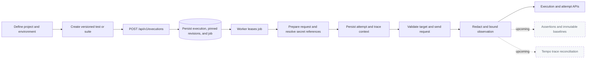
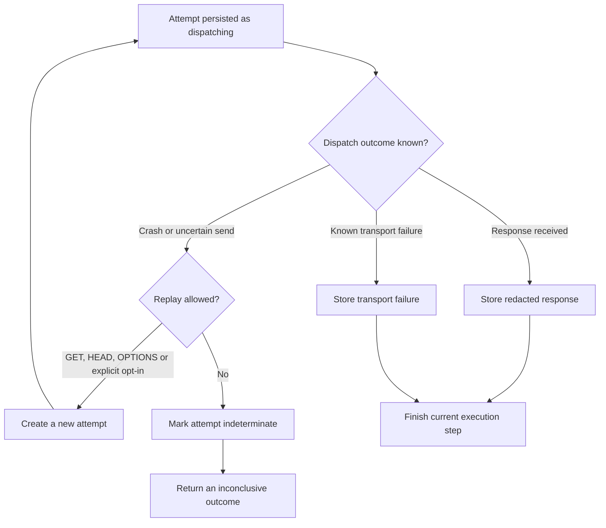
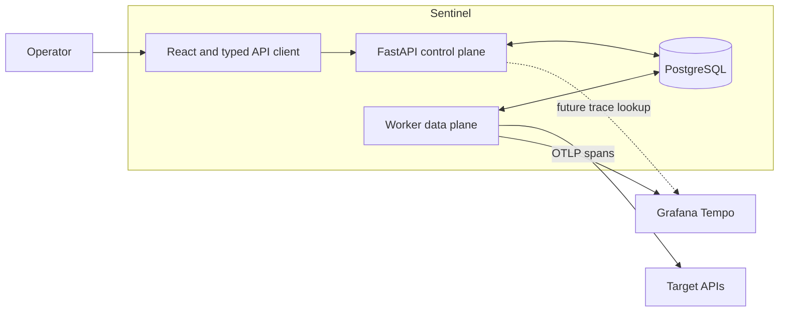

# Sentinel

Sentinel is an open-source, self-hosted platform for deterministic API
regression testing with distributed-trace correlation. It is built for a single
operator running locally or on a trusted development network.

Sentinel is designed to answer three questions with evidence:

1. **What broke?** Which required assertion or explicitly selected baseline
   value changed?
2. **Where did it fail?** Which related spans contain errors or unexpected
   latency?
3. **What changed before the failure?** Which definition, baseline, service
   version, or deployment attribute differs from an earlier run?

Sentinel reports deterministic observations; it does not guess or claim root
cause.

## Why Sentinel

- **Deterministic by design.** Only explicit assertions and baseline selectors
  affect a verdict. Exact response-body comparison is opt-in.
- **Trace-aware, not trace-dependent.** OpenTelemetry evidence enriches a result,
  but missing or delayed telemetry never changes the functional verdict.
- **Safe execution semantics.** Dispatch intent is persisted before network I/O,
  ambiguous non-idempotent requests are not silently replayed, and every replay
  receives new attempt and trace identifiers.
- **Secure local operation.** Secret references, response redaction, bounded
  capture, SSRF defenses, verified TLS, and loopback-only published ports are
  part of the core design.
- **Simple infrastructure.** The API and worker form a modular monolith backed by
  PostgreSQL; no Redis, message broker, or proprietary tracing protocol is
  required.

## Current status

Sentinel is under active MVP development. The current `main` branch includes:

- versioned projects, environments, test cases, and ordered suites;
- immutable definition revisions, change records, strong ETags, and optimistic
  concurrency;
- atomic execution creation, immutable revision pinning, and optional
  `Idempotency-Key` handling;
- a durable PostgreSQL job queue with leases, fencing, heartbeats, bounded retry,
  and crash recovery;
- request preparation with environment variables and out-of-band secret
  resolution;
- a DNS-pinned HTTP adapter with target validation, verified TLS, redirect
  controls, timeouts, bounded response capture, and no implicit proxy or retry;
- conservative replay handling for ambiguous dispatches;
- redacted execution and attempt observations exposed through `/api/v1`;
- W3C Trace Context and Baggage propagation with OpenTelemetry client spans;
- generated OpenAPI TypeScript types, a React application shell, Docker Compose,
  migrations, and CI quality gates.

The remaining MVP work includes deterministic assertion and baseline evaluation,
Tempo trace reconciliation, the complete authoring/results UI, retention, and
release hardening. Milestone 3 implementation currently reaches M3-05; its
independent M3-06 acceptance is still pending. See the
[roadmap](docs/ROADMAP.md) for the ordered delivery plan.

## How it works

Definitions are immutable inputs to an execution. The API creates the execution
and its job in one transaction, then a worker owns the network boundary and
checkpoints each attempt around the outbound request.



PostgreSQL delivery is **at least once**, but a recovered job is not automatic
permission to repeat an HTTP request. If a crash leaves dispatch ambiguous,
Sentinel replays safe methods with a new attempt and marks unsafe requests
inconclusive unless the definition explicitly permits replay.



## Architecture

The backend is one Python package with separate API and worker processes. Domain
modules remain independent from FastAPI, SQLAlchemy, HTTPX, and worker runtime
details; adapters provide those external capabilities.



| Component  | Responsibility                                                                                 |
| ---------- | ---------------------------------------------------------------------------------------------- |
| React      | Presentation and generated, typed API access. The complete product UI is still in development. |
| FastAPI    | Authentication, validation, RFC 9457 problems, catalog operations, and execution APIs.         |
| Worker     | Job leasing, request preparation, safe HTTP dispatch, recovery, and result recording.          |
| PostgreSQL | Source of truth and low-volume durable job queue.                                              |
| Tempo      | OpenTelemetry trace storage; unavailable telemetry does not make functional execution fail.    |

## Technology

- Python 3.12, FastAPI, Pydantic v2, SQLAlchemy 2, Alembic, HTTPX/httpcore
- PostgreSQL 16
- React 19, TypeScript, Vite, and `openapi-fetch`
- OpenTelemetry and Grafana Tempo
- Docker Compose, pytest, Ruff, mypy, Vitest, ESLint, and Prettier
- GitHub Actions

## Prerequisites

- Docker Engine/Desktop with Docker Compose v2.20 or newer for the full stack
- Python 3.12 and [uv](https://docs.astral.sh/uv/) for native backend development
- Node.js 22.12 or newer in the Node 22 release line and npm for frontend work
- PostgreSQL 16 for native integration tests

## Quick start with Docker Compose

Create the local environment file and generate an API token:

```sh
cp .env.example .env
openssl rand -hex 32
```

Paste the generated value into `SENTINEL_API_TOKEN` in `.env`. Change the
default database password before sharing a machine, and keep `.env` private and
uncommitted.

Start PostgreSQL, apply migrations, and launch the stack:

```sh
docker compose --env-file .env -f infra/compose.yaml config --quiet
docker compose --env-file .env -f infra/compose.yaml up -d --wait postgres
docker compose --env-file .env -f infra/compose.yaml run --build --rm api alembic upgrade head
docker compose --env-file .env -f infra/compose.yaml up -d --build --wait --wait-timeout 180
```

Services are published on loopback only:

- frontend shell: `http://127.0.0.1:5173`
- API: `http://127.0.0.1:8000`
- Tempo readiness: `http://127.0.0.1:3200/ready`

Check the stack and exercise the durable worker probe:

```sh
curl --fail http://127.0.0.1:8000/health/live
curl --fail http://127.0.0.1:8000/health/ready
docker compose --env-file .env -f infra/compose.yaml exec -T api python -m sentinel.worker.smoke
docker compose --env-file .env -f infra/compose.yaml logs --tail 100 worker
```

Health endpoints are public and expose no secret configuration. Business routes,
`/docs`, and `/openapi.json` require the configured bearer token because the
container API listens on a non-loopback interface internally.

Stop the stack without deleting its named volumes:

```sh
docker compose --env-file .env -f infra/compose.yaml down
```

Do not add `--volumes` unless you intend to delete local PostgreSQL and Tempo
data.

## Native development

Install locked dependencies and migrate the configured database:

```sh
make setup
uv run --env-file .env --project backend alembic -c backend/alembic.ini upgrade head
```

Run the backend processes in separate terminals:

```sh
uv run --env-file .env --project backend sentinel-api
uv run --env-file .env --project backend sentinel-worker
```

Run the frontend development server:

```sh
npm --prefix frontend run dev
```

The API and worker never run migrations automatically. Native API binding
defaults to `127.0.0.1`; binding to a non-loopback address requires a bearer
token.

## Verification

Use the repository wrappers for local feedback:

```sh
make check-backend
make check-frontend
make check-contract
make check-fast
make check-compose-config
```

`make check-fast` excludes PostgreSQL integration, migration round-trip, and full
Compose acceptance. Integration tests require a dedicated disposable database
whose name ends in `_test`; the fixtures clean database state and must never point
at data you want to keep. Follow the exact isolated recipes in
[local quality gates](docs/development/quality-gates.md).

Runtime OpenAPI and generated TypeScript artifacts are committed. CI regenerates
them and rejects contract drift.

## Repository layout

```text
backend/   FastAPI API, worker, domain modules, persistence, migrations, tests
frontend/  React application, generated API types, component tests
infra/     Docker Compose, Tempo configuration, infrastructure checks
docs/      MVP, architecture, ADRs, operations, roadmap, implementation records
```

## Documentation

- [MVP scope and acceptance contract](docs/MVP.md)
- [Architecture](docs/architecture/README.md)
- [Architecture decision records](docs/architecture/ADRs/)
- [Roadmap](docs/ROADMAP.md)
- [Durable work operations](docs/operations/durable-work.md)
- [Development workflow](docs/development/workflow.md)
- [Engineering guide](AGENTS.md)

## Product boundaries

The MVP is deliberately single-user, local-first, and self-hosted. It does not
include multi-tenancy, billing, AI-generated analysis, scheduling, alerting,
Kubernetes, a dedicated message broker, load testing, or a proprietary tracing
protocol. Those exclusions keep Sentinel focused on reproducible API evidence and
safe recovery.
