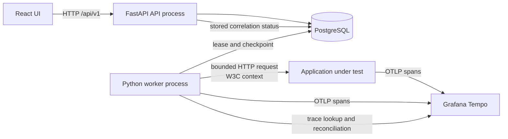
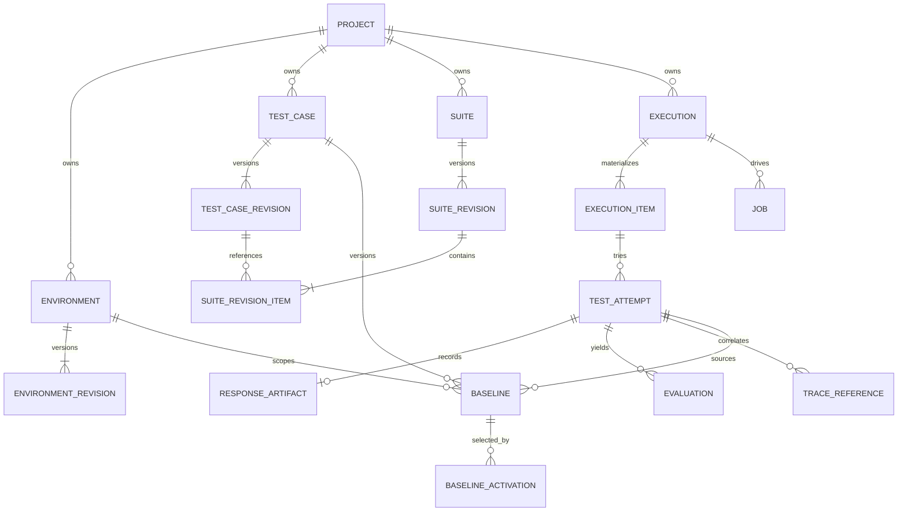

# Sentinel Architecture

## 1. System intent

Sentinel is a local-first modular monolith that executes bounded HTTP API tests,
classifies deterministic regressions, and correlates each possible request
dispatch with OpenTelemetry traces in Grafana Tempo.

The architecture favors auditable behavior over inference:

- Only explicit assertions and selected baseline values can cause a functional
  regression.
- Queue recovery and outbound-request replay are separate decisions.
- Trace evidence can explain where errors were observed, but it does not prove
  root cause.
- Missing telemetry degrades trace insight without changing an API-test verdict.

The product contract and acceptance criteria are in [`../MVP.md`](../MVP.md).

Current implementation status is tracked in the [roadmap](../ROADMAP.md).
Milestones 1, 2, and 3 are accepted; the Milestone 3 implementation is
`a41670b5c9da5410d0bd50d4ceaca495d23998bf`. The runtime includes versioned
definitions, durable executions and attempts, safe HTTP dispatch/recovery,
redacted observations, and execution read APIs. Evaluation/baselines, Tempo
reconciliation, and the complete UI remain later milestones.

The component responsibilities and data model below describe the complete MVP
architecture. Sections that cover later milestones are target contracts, not a
claim that every component is already implemented. Current transaction and
recovery behavior is documented in
[durable work operations](../operations/durable-work.md).

## 2. Context and runtime topology



Required Docker Compose services are `frontend`, `api`, `worker`, `postgres`,
and `tempo`. An OpenTelemetry Collector may be documented as an optional
deployment adapter, but it is not required by the MVP and must not become an
application dependency.

The API and worker use the same Python package and database schema. They are
separate processes so network execution cannot block API request handling and a
worker crash cannot take down the control plane. This remains a modular monolith:
there are no internal network APIs or independently versioned backend services.

## 3. Component responsibilities

### 3.1 Frontend

The React application owns presentation and interaction only. It:

- edits project, environment, test, suite, and baseline resources through the
  versioned API;
- starts executions and polls execution resources with bounded backoff;
- renders backend-owned lifecycle and verdict enums without reimplementing their
  transition rules;
- displays redacted evidence, change records, and trace availability;
- links to the configured Tempo UI when a trace is available.

It never resolves secrets, calls target applications, queries Tempo directly, or
decides whether a result is a regression.

### 3.2 API process

The FastAPI process is the control plane. It:

- validates Pydantic transport schemas;
- invokes application services for definitions, executions, and baselines;
- creates jobs transactionally with executions;
- exposes stored execution and trace-correlation state;
- applies local bearer authentication when required;
- emits stable RFC 9457 problem responses.

It does not perform target HTTP calls or wait synchronously for execution jobs.

### 3.3 Worker process

The worker is the data-plane orchestrator. It:

- claims jobs using PostgreSQL row locks and leases;
- heartbeats leases and checkpoints workflow state;
- prepares and validates outbound requests;
- persists correlation identities before dispatch;
- performs bounded HTTP calls;
- redacts and stores bounded observations;
- invokes deterministic evaluation and verdict classification;
- reconciles known trace IDs with Tempo after asynchronous ingestion;
- runs retention cleanup as an internal scheduled maintenance job.

The worker owns polling and lease mechanics, but job handlers in the application
layer own idempotent workflow decisions.

### 3.4 PostgreSQL

PostgreSQL is the source of truth for definitions, immutable revisions,
executions, jobs, redacted observations, baseline values, evaluation results,
correlation metadata, change records, and retention deadlines.

It is also the low-volume job queue. PostgreSQL does not store full traces or
resolved secrets.

### 3.5 Tempo

Tempo stores OpenTelemetry trace data and remains independently disposable from
the functional test history. Sentinel performs direct lookup by a known trace ID
and, when supported and configured, best-effort search for correlation
attributes. Tempo failure or retention expiration never changes test verdicts.

### 3.6 Application under test

The target application is external to Sentinel. Direct correlation requires it
to extract and propagate W3C Trace Context and export OpenTelemetry spans to the
Tempo installation. Its obligations are specified in
[`../MVP.md`](../MVP.md#what-instrumented-applications-must-provide).

## 4. Backend module boundaries

The intended package root is `backend/src/sentinel/`.

| Module | Owns | May depend on |
| --- | --- | --- |
| `catalog` | Projects, environment/test/suite revisions, change records | Shared domain primitives |
| `execution` | Executions, items, attempts, jobs, orchestration state machines | Catalog contracts, security/HTTP/telemetry ports |
| `regression` | Assertions, normalization, baselines, diffs, verdicts | Immutable catalog value types |
| `telemetry` | Trace context, trace references, Tempo reconciliation policy | Execution identity types and telemetry ports |
| `security` | Secret references, redaction, target policy, retention policy | Shared primitives |
| `persistence` | SQLAlchemy mappings, repositories, unit of work, migrations | Public domain contracts from owning modules |
| `api` | FastAPI routes, schemas, auth, dependency composition | Application services only |
| `worker` | Poll loop, lease heartbeat, handler dispatch, process lifecycle | Execution application services only |

Each domain module contains framework-independent entities and policies plus
application services and port protocols. Concrete HTTPX, SQLAlchemy, Tempo, and
OpenTelemetry adapters live at the outer edge. Cross-module writes occur through
application services inside one database transaction, not through direct ORM
access from another module.

Dependency direction is inward: transport and infrastructure depend on
application/domain contracts. Domain modules do not import FastAPI, SQLAlchemy,
HTTPX, OpenTelemetry SDK implementations, or worker code.

## 5. Main data model

All public identifiers are UUIDs. All timestamps are UTC `timestamptz`. Lifecycle
states are relational enum/string columns, not opaque JSON. JSONB is reserved for
versioned documents and redacted bounded artifacts.

### 5.1 Catalog and revision entities

| Entity | Important fields | Relationships and invariants |
| --- | --- | --- |
| `Project` | `id`, `name`, `created_at`, `deleted_at` | Owns environments, test cases, suites, and executions. Names are unique among undeleted projects. |
| `Environment` | `id`, `project_id`, `name`, `active_revision_id` | Stable identity and activation pointer. |
| `EnvironmentRevision` | `id`, `environment_id`, `version`, `base_url`, `variables_json`, `target_policy_json`, `created_at` | Immutable. Contains secret references but never secret values. Unique `(environment_id, version)`. |
| `TestCase` | `id`, `project_id`, `name`, `active_revision_id` | Stable identity and activation pointer. |
| `TestCaseRevision` | `id`, `test_case_id`, `version`, `request_json`, `assertions_json`, `comparison_policy_json`, `policy_fingerprint`, `allow_unsafe_replay`, `created_at` | Immutable. Unique `(test_case_id, version)`. Fingerprint is canonical and deterministic. |
| `Suite` | `id`, `project_id`, `name`, `active_revision_id` | Stable identity and activation pointer. |
| `SuiteRevision` | `id`, `suite_id`, `version`, `created_at` | Immutable ordered definition. |
| `SuiteRevisionItem` | `suite_revision_id`, `ordinal`, `test_case_revision_id` | Unique ordinal and case membership per suite revision. |
| `ChangeEvent` | `id`, `project_id`, `kind`, `subject_type`, `subject_id`, `before_ref`, `after_ref`, `summary_json`, `created_at` | Append-only evidence for definition, environment, suite, and baseline activation changes. Contains no secrets or raw bodies. |

Executions pin immutable environment and test/suite revisions. Changing an active
definition never alters an existing or queued execution.

### 5.2 Execution and queue entities

| Entity | Important fields | Relationships and invariants |
| --- | --- | --- |
| `Execution` | `id`, `project_id`, `environment_revision_id`, `source_type`, `source_revision_id`, `status`, `verdict`, `created_at`, `started_at`, `finished_at` | One requested run. `source_type` is `test_case` or `suite`. Verdict is nullable until terminal. |
| `ExecutionItem` | `id`, `execution_id`, `ordinal`, `test_case_revision_id`, `status`, `verdict` | Materialized ordered case list. A single-case execution has one item. |
| `TestAttempt` | `id`, `execution_item_id`, `sequence`, `state`, `dispatch_certainty`, `request_fingerprint`, `dispatch_recorded_at`, `response_recorded_at`, `duration_ms`, `transport_outcome`, `preparation_error_code`, `redirect_rejection_code`, `replayed_by_attempt_id`, `primary_trace_id`, `client_span_id` | One configured dispatch boundary, including its bounded redirect chain. A replay always creates a new row and identifiers and links the ambiguous predecessor. Unique `(execution_item_id, sequence)`. |
| `ResponseArtifact` | `id`, `attempt_id`, `status_code`, `headers_json`, `body_kind`, `redacted_body`, `truncated`, `expires_at` | At most one bounded, redacted observation per attempt. Raw secrets and unbounded bodies are forbidden. |
| `Evaluation` | `id`, `attempt_id`, `kind`, `rule_id`, `severity`, `outcome`, `expected_json`, `actual_json`, `message_code` | One assertion, selector, or performance evaluation. Evidence is redacted and bounded. |
| `Job` | `id`, `kind`, `subject_id`, `state`, `available_at`, `lease_owner`, `lease_token`, `lease_expires_at`, `delivery_count`, `max_deliveries`, `last_error_code`, `created_at`, `finished_at` | Durable work item. `subject_id` identifies an execution or trace reconciliation target. Payloads carry IDs, not secret-bearing request documents. |
| `IdempotencyRecord` | `key_hash`, `request_hash`, `execution_id`, `expires_at` | Makes execution creation idempotent for 24 hours. The raw key need not be stored. |

`TestAttempt` is intentionally conservative: after `dispatching` is committed,
Sentinel treats the request as possibly sent even if the process died before the
socket write. This avoids silently duplicating non-idempotent effects.

`dispatch_certainty` is `not_started`, `not_sent`, `possibly_sent`, or
`response_received`. The checkpoint writes `possibly_sent`; only positive
pre-write phase proof under a live fenced lease can later record `not_sent`.
Certainty is attempt-wide across a redirect chain: `not_sent` proves no hop wrote
HTTP bytes, while a later unresolved write is `possibly_sent` even if an earlier
hop returned `3xx`.

### 5.3 Baseline and trace entities

| Entity | Important fields | Relationships and invariants |
| --- | --- | --- |
| `Baseline` | `id`, `test_case_id`, `environment_id`, `version`, `source_attempt_id`, `test_case_revision_id`, `policy_fingerprint`, `values_json`, `created_at`, `reason` | Immutable selected, normalized, redacted values. Unique `(test_case_id, environment_id, version)`. Source attempt must be fully evaluated and compatible. |
| `BaselineActivation` | `id`, `test_case_id`, `environment_id`, `baseline_id`, `activated_at`, `superseded_at` | Append-only activation history. Exactly one unsuperseded row per case/environment. |
| `TraceReference` | `id`, `attempt_id`, `relation`, `trace_id`, `span_id`, `correlation_source`, `status`, `first_checked_at`, `last_checked_at`, `deadline_at`, `last_error_code` | One primary reference per attempt and zero or more linked references. Trace IDs are 32 lowercase hex characters; span IDs are 16. |

`relation` is `primary` or `linked`. `correlation_source` is
`sentinel_context` for the primary trace or `baggage_attribute_search` for a
best-effort linked trace. Linked references are never represented as descendants
unless their trace data actually records that relationship.

### 5.4 Relationship overview



## 6. State machines

### 6.1 Job state

```text
pending --claim--> leased --handler success--> succeeded
   ^                  |
   |                  +--retryable infrastructure failure--> pending (backoff)
   |                  +--expired + atomic reclaim-----------> leased (new token)
   |                  +--non-retryable/exhausted------------> dead
   +---------------------------------------------------------+
```

Claiming increments `delivery_count`. An expired `leased` job is eligible for
atomic reclaim only while `delivery_count < max_deliveries`; otherwise the
reclaimer marks it `dead`. `succeeded` and `dead` are terminal. Full leasing
semantics are in ADR 0002.

### 6.2 Execution and item state

```text
Execution:     queued -> running -> completed
                                  -> failed

ExecutionItem: pending -> running -> completed
                                  -> indeterminate
                                  -> failed
               pending ----------> skipped
```

- `completed` execution means orchestration finished, not that tests passed.
- `failed` execution means the platform exhausted job delivery or hit a terminal
  internal failure. Its verdict is `not_evaluated` unless an item already yielded
  a stronger recorded result.
- An `indeterminate` item causes an `inconclusive` execution verdict. Remaining
  suite items are skipped by default to avoid compounding unknown side effects.
- A suite completes after every item is completed or explicitly skipped.

### 6.3 Attempt state

```text
prepared
  |-- failed (request preparation or static policy rejection)
  `-- dispatching
        |-- response_received --> evaluated
        |                         `-- failed (evaluation cannot be recovered)
        |-- transport_failed
        |-- replay_scheduled --> new prepared attempt
        `-- indeterminate
```

The transaction entering `dispatching` also persists the request fingerprint,
trace ID, client span ID, and `possibly_sent` certainty. DNS and all destination
network I/O start only after commit. `transport_failed` is a durable terminal
transport or redirect-policy outcome without an accepted final response; it is
never recovered by resending. Recovery of `response_received` resumes evaluation
without resending. Recovery of `dispatching` consults replay policy; a replayable
case marks the old attempt `replay_scheduled`, creates a new linked `prepared`
attempt, and excludes the old attempt from verdict aggregation after the successor
evaluates. A non-replayable case becomes terminal `indeterminate` and drives an
inconclusive verdict. ADR 0008 defines the exact certainty proofs and outcome
matrix.

### 6.4 Trace-correlation state

```text
pending -> missing -------> available
   |          |                 ^
   |          +-> partial ------+
   |          +-> expired
   +-> tempo_unavailable -> pending (retry before deadline)
   +-> partial -----------> available
```

- `pending`: dispatch is recorded but no lookup completed.
- `missing`: lookup returned no trace before the correlation deadline; it remains
  retryable because Tempo ingestion may be delayed.
- `available`: the primary trace and stored client span are found.
- `partial`: some trace evidence exists, but the client span, downstream spans,
  or expected context continuity is absent.
- `tempo_unavailable`: the latest lookup could not reach Tempo. It is retryable
  until the deadline and remains distinguishable if retries exhaust.
- `expired`: the lookup window ended with no trace. Trace retention may later
  remove an `available` trace; the UI must then say retained correlation metadata
  exists but trace content has expired.

None of these states changes an execution verdict.

## 7. API testing lifecycle

### 7.1 Definition and queueing

1. The API validates the active immutable revisions and environment ownership.
2. In one transaction, it creates the execution, materializes ordered execution
   items, inserts an `execute_execution` job, and stores any idempotency record.
3. It returns `202 Accepted`, `Location`, and the queued execution.

### 7.2 Claim and preparation

1. The worker atomically claims a runnable job with `FOR UPDATE SKIP LOCKED`,
   assigns its worker ID, sets its lease deadline, and increments delivery count.
2. The handler locks the execution, observes its durable state, and performs only
   the next unfinished transition. Re-delivery of completed work is a no-op.
3. It resolves non-secret variables and secret references in memory, performs
   static URL/scheme/userinfo/port and TLS-policy checks, applies limits, and
   creates a canonical request fingerprint that excludes resolved secret values.
4. It allocates an attempt ID, primary trace ID, and client span ID.

### 7.3 Dispatch checkpoint and HTTP call

1. A short fenced transaction records the attempt as `dispatching` with
   correlation identifiers and `possibly_sent` certainty. It commits before DNS
   or any destination socket operation.
2. The HTTP adapter resolves and validates every address, chooses a permitted
   address, connects only to that address while retaining original-host HTTP
   authority and TLS SNI/hostname verification, creates the recorded OpenTelemetry
   client span, injects W3C context and Sentinel correlation baggage, and sends
   one bounded configured request and any permitted redirect hops.
3. The worker heartbeats the job lease independently of the HTTP timeout.
4. The response or transport outcome is converted to a bounded in-memory
   observation. Secret-bearing fields are redacted before logging or persistence.
5. A fenced transaction either writes the accepted final response artifact and
   changes the attempt to `response_received`, or records the sanitized outcome
   and changes it to `transport_failed`. A stale worker writes neither.

### 7.4 Evaluation and classification

1. Parse content only when its configured evaluator needs it.
2. Apply deterministic normalizers to selected values.
3. Evaluate required assertions and required baseline selectors.
4. Evaluate advisory selectors and performance limits separately.
5. Persist evaluations and the attempt verdict, then aggregate item and execution
   verdicts using the precedence in `docs/MVP.md`.
6. Mark the attempt `evaluated`. When all items are terminal, mark the execution
   `completed` and the execution job `succeeded` in coordinated transactions.

### 7.5 Trace reconciliation

1. Dispatch creates a `TraceReference` immediately; trace identity never depends
   on Tempo ingestion.
2. A separate `correlate_trace` job performs direct trace-ID lookup after a short
   delay and retries with bounded backoff until its deadline.
3. The reconciler validates that the stored client span is present and records
   `available`, `partial`, `missing`, `tempo_unavailable`, or `expired`.
4. If Tempo attribute search is enabled, it may discover other traces whose spans
   record the attempt baggage. Those become `linked` references with indirect
   provenance.
5. The API exposes stored correlation state; no UI request has to block on Tempo.

## 8. Deterministic regression policy

### 8.1 Canonical policy

Every test revision stores a canonical comparison policy and its SHA-256
fingerprint. Canonicalization sorts object keys, preserves array order unless a
declared normalizer changes it, uses JSON-native scalar types, and excludes UI
metadata. The same canonical document must produce the same fingerprint across
processes.

### 8.2 Selection instead of volatile-field guessing

JSON baseline comparison starts from an empty selection. The operator explicitly
adds RFC 6901 JSON Pointers and an evaluation severity. All unselected fields are
ignored. Sentinel may provide static UI shortcuts for common field names, but it
must not silently add or remove selectors based on observed values.

This means timestamps, UUIDs, request IDs, randomized ordering, and other volatile
values are not compared unless the operator deliberately selects and normalizes
them. Exact whole-body comparison remains an explicit policy choice.

### 8.3 Classification

- A failed required assertion or required baseline selector is a
  `functional_regression`.
- An advisory mismatch is `observed_change`.
- A duration threshold breach is `performance_warning` if functional checks pass.
- Incompatible/missing required baseline data is `baseline_required`.
- Ambiguous dispatch, truncation required for evaluation, or uncertain transport
  is `inconclusive`.
- Trace state is not an input to classification.

Evidence identifies the rule, normalized expected value, redacted actual value,
and deterministic message code. It does not contain speculative causes.

### 8.4 Baseline creation

An attempt is eligible only if it is `evaluated`, its response was not truncated
for any selected value, all required explicit assertions passed, its policy
fingerprint matches the target test revision, and its redacted selected values
can be serialized canonically. Promotion creates a new version and activation
record in one transaction. A reason is optional but recommended.

## 9. Identity and trace relationships

| Identifier | Cardinality | Meaning |
| --- | --- | --- |
| `execution_id` | One per requested test/suite run | Stable business workflow identity. Never placed in a trace-ID field. |
| `execution_item_id` | One per materialized case in a run | Connects suite order and case revision to attempts. |
| `attempt_id` | One per possible network dispatch checkpoint | Stable identity for response/evaluation/correlation. New on replay. |
| `trace_id` | One primary per dispatched attempt; optional linked traces | OpenTelemetry 128-bit trace identity. New on replay. |
| `client_span_id` | One primary per dispatched attempt | Sentinel HTTP client span within the primary trace. New on replay. |

The primary trace is generated by Sentinel before dispatch. If propagation works,
the target server span is a descendant of the stored client span in the same
trace. If a service starts a new trace, Sentinel cannot prove a parent/child
relationship. It may show a linked trace only when standard baggage was copied to
a searchable span attribute, and labels the evidence as indirect.

A suite normally has multiple attempts and therefore multiple primary traces. A
safe replay also produces multiple attempts/traces for one execution item. This
is expected and retained in history rather than collapsed.

## 10. API contracts

The endpoint inventory is normative in `docs/MVP.md`. This section defines shared
wire behavior.

### 10.1 Resource conventions

- JSON uses `snake_case` to match persisted schemas and Python models.
- IDs are canonical UUID strings; timestamps are RFC 3339 UTC strings.
- List responses use `{ "items": [...], "next_cursor": "..." }` with opaque
  cursor pagination. Offset pagination is not exposed.
- Mutable metadata resources return strong `ETag` values and require `If-Match`
  for update. A stale value returns `412 Precondition Failed`.
- Creation returns `201 Created`, except asynchronous execution creation returns
  `202 Accepted`.
- Validation errors use stable problem `type`, `title`, `status`, `code`, and an
  optional list of field errors. Details never echo secret values.

### 10.2 Execution creation

```json
{
  "environment_id": "00000000-0000-4000-8000-000000000001",
  "test_case_id": "00000000-0000-4000-8000-000000000002"
}
```

Exactly one of `test_case_id` and `suite_id` is required. The active revision IDs
are resolved and pinned inside the creation transaction. Optional
`Idempotency-Key` semantics are defined in `docs/MVP.md`.

An execution response includes `id`, `status`, nullable `verdict`, pinned revision
references, ordered item summaries, timestamps, and links. Attempt details and
redacted bodies are separate resources so history lists remain bounded.

### 10.3 Test revision document

The revision document has these stable top-level sections:

```json
{
  "request": {
    "method": "GET",
    "path": "/v1/orders/{{variables.order_id}}",
    "query": [],
    "headers": [{"name": "Authorization", "value": {"$secret": "API_TOKEN"}}],
    "body": null,
    "timeout_ms": 30000,
    "follow_redirects": false
  },
  "assertions": [],
  "comparison_policy": {
    "selectors": [],
    "exact_text_body": false,
    "performance_threshold_ms": null
  },
  "redaction": {
    "json_pointers": [],
    "header_names": []
  },
  "allow_unsafe_replay": false
}
```

The API rejects user-supplied `traceparent`, `tracestate`, and Sentinel-owned
baggage keys because Sentinel must own correlation context. It always redacts the
fixed sensitive-header set even if a revision omits it.

### 10.4 Baseline actions

Creating and activating a baseline are distinct commands, even when creation
activates the new version in the same transaction.

```json
{
  "environment_id": "00000000-0000-4000-8000-000000000001",
  "source_attempt_id": "00000000-0000-4000-8000-000000000003",
  "reason": "Reviewed order response after intentional contract change"
}
```

`POST /api/v1/test-cases/{test_case_id}/baselines` validates project ownership,
source eligibility, environment scope, and policy fingerprint. It returns
`201 Created` with the immutable baseline and current activation. Concurrent
promotion is serialized per test-case/environment scope so version numbers and
the one-active-baseline invariant remain valid.

`POST /api/v1/test-cases/{test_case_id}/baseline-activations` accepts
`environment_id`, `baseline_id`, and optional `reason`. It may reactivate an older
compatible version and returns `201 Created` with the new activation history row.

### 10.5 Stable problem codes

HTTP status alone is not the programmatic error contract. Problem responses
include one of these initial stable codes:

| Code | HTTP status | Meaning |
| --- | --- | --- |
| `validation_failed` | `422` | Transport shape or domain value is invalid. |
| `resource_not_found` | `404` | The resource does not exist in the requested project scope. |
| `revision_conflict` | `412` | `If-Match` does not match current mutable metadata/activation state. |
| `idempotency_conflict` | `409` | An idempotency key was reused with a different request. |
| `baseline_ineligible` | `409` | The source attempt cannot safely become a baseline. |
| `baseline_incompatible` | `409` | The baseline policy fingerprint does not match. |
| `secret_reference_invalid` | `422` | A secret reference name or placement is invalid. |
| `authentication_required` | `401` | A remote-bound installation requires its bearer token. |
| `forbidden_origin` | `403` | Browser origin is not configured. |

Execution-time failures such as target-policy denial, missing secret value,
transport timeout, or invalid target JSON belong to the durable attempt result;
they are not retroactively returned by the asynchronous creation request.

## 11. Failure behavior

| Failure | Recorded behavior | Retry/recovery | User-facing meaning |
| --- | --- | --- | --- |
| Worker dies before `dispatching` commit | Attempt is absent or `prepared` | Reclaimed job may continue; no request is considered sent | Execution resumes |
| Worker dies after `dispatching` commit | Attempt remains ambiguous | Replay only if policy permits, always as a new attempt | `inconclusive` when replay is forbidden |
| Worker dies after response checkpoint | Response remains redacted and durable | Resume evaluation without another HTTP call | Execution resumes |
| Worker dies after observing a response but before its fenced checkpoint | Durable attempt remains `dispatching`/`possibly_sent`; in-memory evidence is discarded | Apply ambiguous recovery; stale worker cannot write | May replay only under accepted policy or become `inconclusive` |
| Lease heartbeat temporarily fails | Handler stops new side effects when lease ownership cannot be confirmed | Another worker reclaims after expiration | Possible delay, never assumed ownership |
| Job exceeds delivery limit | Job becomes `dead` | No automatic retry | Execution `failed`; usually `not_evaluated` |
| DNS/TLS/connect failure before request write | `transport_failed` with positive `not_sent` proof | No automatic retry | Explicit safe outcome; ordinarily `inconclusive` |
| Write/read/total timeout or connection loss after transmission may begin | `transport_failed` with `possibly_sent`, or `response_received` certainty after a response head | No automatic retry | `inconclusive`, not guessed root cause |
| Response exceeds capture limit | Artifact marked truncated | No refetch | Evaluate available metadata; content-dependent checks are inconclusive |
| `3xx` while redirects are disabled | Accepted final response | No redirect | Status is ordinary response evidence |
| Proposed redirect hop is rejected | Received `3xx` is sanitized evidence; attempt is `transport_failed`/`redirect_denied` with `response_received` certainty | No connection to rejected hop | Explicit redirect policy outcome |
| Invalid JSON for JSON check | Parse evaluation failure | No retry | Required JSON rule fails with deterministic evidence |
| Missing secret reference | Preparation failure before dispatch | No HTTP call; fix configuration and start a new run | Execution item failed/not evaluated |
| Target denied by network policy | Preparation/redirect failure | No HTTP call to denied address | Explicit policy error |
| Baseline absent/incompatible | No baseline comparison | No auto-promotion | `baseline_required` |
| Tempo returns not found | Correlation `missing` | Retry until deadline | Functional result remains available |
| Tempo unavailable | Correlation `tempo_unavailable` | Bounded correlation retry | Functional result remains available |
| Trace lacks expected client/downstream spans | Correlation `partial` | May recheck until deadline | Evidence is incomplete |

## 12. Security, privacy, and retention architecture

### 12.1 Secret flow

Definitions store secret names only. At dispatch, the security adapter resolves
the name from an operator-managed process or mounted-secret environment variable.
The value exists only in worker memory for request construction. Request
fingerprints use the secret reference name plus a constant placeholder, never the
value. OpenTelemetry attributes and logs receive sanitized metadata only.

### 12.2 Redaction order

1. Fixed sensitive headers are removed or replaced with `[REDACTED]`.
2. Operator-configured header names and JSON Pointers are redacted.
3. Capture limits are applied while streaming; an oversized body is not buffered
   in full merely to redact it.
4. Only the redacted bounded representation enters logs, evaluation evidence,
   PostgreSQL, API responses, or test snapshots.

When a body cannot be safely parsed for configured field-level redaction, the
entire body is omitted from persistence and marked `redaction_unavailable`.

### 12.3 Outbound network policy

The HTTP adapter resolves and validates every destination and redirect hop. It
blocks dangerous address classes by default and allows explicit operator
hostname/CIDR exceptions for intentional local testing. The connection must be
made to a selected validated address without a second hostname resolution. HTTP
authority, TLS SNI, and certificate hostname verification retain the canonical
original hostname. DNS occurs only after the durable `dispatching` checkpoint.

HTTPS requires certificate-chain and hostname verification with TLS 1.2 or
newer. Default trust roots may be extended by one deployment-wide PEM CA bundle;
insecure verification, per-environment trust, mTLS, and TLS early data are outside
the MVP. A stored `verify_tls: false` definition fails before DNS or socket I/O
with `tls_verification_required` and is never silently coerced.

Target clients inherit no proxy settings, perform no library retry, and use no
connection pooling in the MVP. Redirects are opt-in, bounded, and followed only
for `GET`, `HEAD`, and `OPTIONS`. Every proposed hop is validated before
connection. Cross-origin hops remove fixed credentials and every secret-derived
header. A rejected hop receives no TCP/TLS/HTTP connection; the preceding `3xx`
is retained only as bounded sanitized evidence with its Location value redacted.
See ADRs 0007 and 0008.

### 12.4 Retention

A daily maintenance job deletes expired response artifacts first, then old
evaluation/attempt/execution metadata when no retained baseline or activation
references it. Baseline selected values are stored independently of artifacts.
Tempo retention is configured independently. Cleanup is idempotent, chunked, and
bounded so it does not monopolize queue/database capacity.

Default periods are defined in `docs/MVP.md`. Project deletion is explicit and
must surface its cascade before confirmation; implementation of project deletion
is not required for the first release if retention can meet the MVP criteria.

## 13. Observability of Sentinel

Sentinel instruments its API, worker, PostgreSQL calls, queue handling, HTTP
client, and Tempo client with OpenTelemetry. Internal spans must not include
secret values or captured bodies.

Minimum metrics/log events include:

- jobs claimed, completed, retried, lease-expired, and dead by kind;
- lease age and handler duration;
- executions and verdicts by project/test identifier (not test payload);
- HTTP transport outcome and bounded duration;
- trace correlation state and lookup latency;
- redaction fallback and response truncation counts.

The worker ID is an ephemeral process identifier used for lease ownership. It is
not a user identity.

## 14. Monorepo structure

```text
sentinel/
├── AGENTS.md
├── backend/
│   ├── pyproject.toml
│   ├── alembic.ini
│   ├── migrations/
│   ├── src/sentinel/
│   │   ├── api/
│   │   ├── worker/
│   │   ├── catalog/
│   │   ├── execution/
│   │   ├── regression/
│   │   ├── telemetry/
│   │   ├── security/
│   │   └── persistence/
│   └── tests/
│       ├── unit/
│       ├── integration/
│       └── contract/
├── frontend/
│   ├── package.json
│   ├── src/
│   │   ├── features/
│   │   │   ├── catalog/
│   │   │   ├── executions/
│   │   │   ├── baselines/
│   │   │   └── traces/
│   │   └── shared/
│   └── tests/
├── infra/
│   ├── compose.yaml
│   ├── tempo/
│   └── examples/
├── docs/
│   ├── MVP.md
│   ├── ROADMAP.md
│   └── architecture/
│       ├── README.md
│       └── ADRs/
└── .github/workflows/
```

Generated OpenAPI client artifacts, if committed, live under
`frontend/src/shared/api/generated/` and are regenerated in CI to detect drift.

## 15. Technical limitations and evolution triggers

### PostgreSQL queue

The queue is intentionally limited to low-volume, single-installation work. Row
churn, polling load, lock contention, database maintenance coupling, and lack of
broker-native routing or consumer lag tooling are accepted MVP costs. A dedicated
broker requires measured evidence and an ADR; triggers are listed in ADR 0002.

### Execution semantics

Sentinel cannot guarantee exactly-once effects against an arbitrary HTTP target.
The conservative pre-dispatch checkpoint creates a false-positive ambiguity
window. Tests with side effects should use disposable data or target-supported
idempotency keys.

### Comparison

Selected-field equality is explainable but deliberately less expressive than a
general scripting language. Custom code assertions and learned volatility are
out of scope because they weaken safety and reproducibility.

### Tracing

Direct correlation ends wherever context propagation breaks. Indirect baggage
search depends on application behavior and Tempo indexing. Sampling and retention
can remove evidence. Clock skew can distort span timelines.

### Security

Single-token remote access is not multi-user authorization. Outbound HTTP testing
is inherently SSRF-capable when operators broaden the allowlist. The deployment
boundary and operator configuration remain part of the security model.

## 16. Decision index

- [ADR 0001: Modular monolith with separate API and worker processes](ADRs/0001-modular-monolith.md)
- [ADR 0002: PostgreSQL-backed job leasing](ADRs/0002-postgresql-job-queue.md)
- [ADR 0003: Explicit deterministic regression classification](ADRs/0003-deterministic-regression-detection.md)
- [ADR 0004: Immutable, versioned baseline management](ADRs/0004-immutable-baselines.md)
- [ADR 0005: OpenTelemetry trace correlation](ADRs/0005-opentelemetry-trace-correlation.md)
- [ADR 0006: Secret handling, redaction, and retention](ADRs/0006-security-privacy-retention.md)
- [ADR 0007: Conservative outbound execution safety](ADRs/0007-outbound-execution-safety.md)
- [ADR 0008: HTTP dispatch outcomes and TLS policy](ADRs/0008-http-dispatch-outcomes-and-tls-policy.md)
